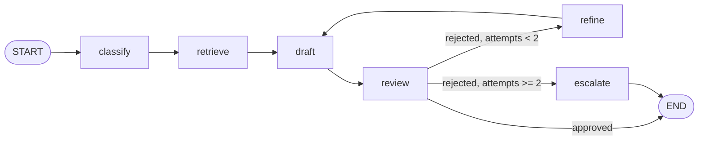

# Support Ticket Resolution Agent (LangGraph + Gemini)

A small agentic workflow that takes a support ticket (subject + description), classifies it, retrieves relevant knowledge-base snippets, drafts a reply with Google Gemini, and then runs the draft through an automated review loop. If the draft fails review twice, the ticket is escalated and logged for a human. Built with LangGraph so the whole flow is an explicit, inspectable state graph.

**Demo video:** https://drive.google.com/file/d/1eej4YwopIwttdGmlsldtZUGUMug5ah-s/view?usp=sharing

## How it works

The graph is defined in `app/graph.py` and compiled as `graph` (registered as `agent` in `langgraph.json`).



| Node | What it does (see `app/nodes.py`) |
| --- | --- |
| `classify` | Keyword matching on subject + description assigns one of `Billing`, `Technical`, `Security`, `General` (default `General`). |
| `retrieve` | Similarity search (top 3) against the Chroma vector store for that category, using Gemini embeddings (`app/rag.py`). |
| `draft` | Calls `gemini-2.5-flash` (temperature 0.2) with the ticket and retrieved context, instructing it to open with a greeting, present the grounded facts as `- ` bullet points followed by next steps, and never promise refunds. |
| `review` | Rule-based checks: no refund promise without "escalate"/"approval", must open with a greeting (`hi`/`hello`/`hey`/`dear` as a whole word within the first 40 characters), must contain a `- ` bullet grounded in context, and must be at least 40 characters. Rejections increment `attempts`. |
| `refine` | Appends the longer words from the reviewer feedback to the query and re-retrieves context, then loops back to `draft`. |
| `escalate` | After two rejected drafts, appends the ticket, all drafts, reviews, queries and context to `data/escalation_log.csv`. |

State is a `TypedDict` (`app/types.py`). List fields such as `queries`, `context`, `drafts`, `reviews` and `history` use an additive reducer, so every step is accumulated and the final state contains a full trace of the run.

## Tech stack

- Python 3.11+
- [LangGraph](https://github.com/langchain-ai/langgraph) for the state graph and routing
- [LangChain](https://github.com/langchain-ai/langchain) + `langchain-google-genai` for Gemini chat (`gemini-2.5-flash`) and embeddings (`models/gemini-embedding-001`)
- [Chroma](https://github.com/chroma-core/chroma) via `langchain-chroma` as the vector store
- LangGraph CLI / Studio (`langgraph dev`) for local development

## Project structure

```
Support-Agent/
├── app/
│   ├── __init__.py
│   ├── graph.py        # StateGraph wiring and the review routing logic
│   ├── nodes.py        # classify / retrieve / draft / review / refine / escalate
│   ├── rag.py          # sample knowledge base + Chroma retrieval with Gemini embeddings
│   └── types.py        # TypedDict state schema
├── data/
│   └── escalation_log.csv   # created at runtime by the escalate node (git-ignored)
├── .env.example
├── langgraph.json      # LangGraph CLI config (graph id: "agent")
├── pyproject.toml
└── README.md
```

## Setup

1. Create and activate a virtual environment:

   ```bash
   python -m venv .venv
   # Windows
   .\.venv\Scripts\activate
   # macOS / Linux
   source .venv/bin/activate
   ```

2. Install the project (dependencies are declared in `pyproject.toml`) and the LangGraph CLI:

   ```bash
   pip install -e .
   pip install --upgrade "langgraph-cli[inmem]"
   ```

3. Add your Gemini API key. Copy `.env.example` to `.env` and fill in the value:

   ```
   GOOGLE_API_KEY=your_google_api_key_here
   ```

   Get a key from [Google AI Studio](https://aistudio.google.com/app/apikey).

## Running

### Option A: LangGraph Studio

```bash
langgraph dev
```

This starts the local LangGraph server using `langgraph.json` (which also loads `.env`) and opens LangGraph Studio in the browser. Select the `agent` graph and submit an input such as:

```json
{
  "subject": "Charged twice for July invoice",
  "description": "I was billed two times for the Pro plan. Please refund the duplicate charge."
}
```

Studio shows each node's state update, so you can watch the draft / review / refine loop.

### Option B: Python

```python
from dotenv import load_dotenv
load_dotenv()  # must run before importing app.graph: app/rag.py reads GOOGLE_API_KEY at import time

from app.graph import graph

result = graph.invoke({
    "subject": "Charged twice for July invoice",
    "description": "I was billed two times for the Pro plan. Please refund the duplicate charge.",
})

print(result["category"])
print(result["draft"])
print("\n".join(result["history"]))
```

The first run creates `.chroma_<Category>/` directories in the working directory for the persisted vector stores; later runs open the existing stores and only add the sample documents if a collection is empty.

## Example

For the billing ticket above, the run proceeds as:

```
classify -> Billing
retrieval -> 2 docs
draft -> generated (Gemini)
review -> approved
```

The retrieved context contains "Refunds require approval from Billing; never promise refunds in replies", so Gemini drafts a greeting followed by `- ` bullets that say the duplicate charge will be escalated to Billing for approval rather than promising a refund, and the rule-based reviewer approves it. If a draft fails review (for example by promising a refund), the graph runs `refine -> draft -> review` again, and after two rejections the ticket is written to `data/escalation_log.csv` with every draft, review, query and context snippet attached, ready for a human agent.

## Limitations / next steps

- **Keyword classifier.** `classify` counts keyword hits per category; it has no fallback to the LLM and is easy to misroute. Swapping in an LLM or embedding-based classifier would be the first improvement.
- **Context accumulates across retries.** Because `context` uses an additive reducer, the second draft sees the first retrieval's documents plus the refined ones.
- **No tests.** There is no automated test suite; unit tests for the routing function and the review rules would be straightforward to add.
- **Escalation log is a CSV.** Fine for a demo; a queue or ticketing-system integration would replace it in practice.
